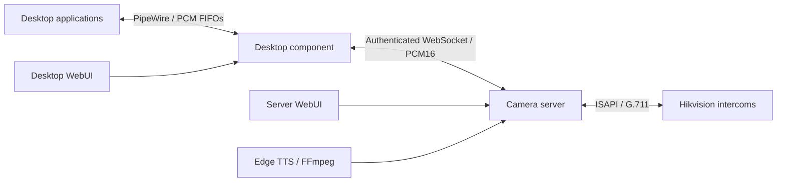

# Hikvision Audio Bridge

One Python distribution, two independently deployed components:

- **`hikvision-audio-server`** owns camera configuration, encrypted passwords,
  shared ISAPI connections, client sessions, a management WebUI and queued TTS.
- **`hikvision-audio`** runs on each Linux desktop. Its separate WebUI manages
  backend pairing, camera groups and independently named PipeWire devices.



A camera channel has one server-owned session, even when several desktops use it.
Speakers fan playback out to their selected cameras; microphones receive a mix of
those cameras. Concurrent live sources mix with the current TTS announcement.
No RTSP/video, vendor SDK, camera configuration changes or audio recording is used.

## Requirements

**Server:** Python 3.13+, `uv`, camera network access, and FFmpeg plus Internet access
for optional online Edge TTS. A logged-in desktop, PipeWire and Secret Service are
not required. Use an unprivileged service account; container/host root is trusted.

**Desktop:** a logged-in Linux systemd user session, PipeWire, `pipewire-pulse`,
WirePlumber, `pactl` (`libpulse` on Arch), Python 3.13+, `uv`, and an unlocked desktop
Secret Service. Native PulseAudio and unattended desktop startup without an
unlocked keyring are not supported deployment targets.

**Cameras:** ISAPI two-way audio with Digest authentication and an existing
`G.711alaw` or `G.711ulaw`, 8 kHz mono channel. Do not register the same physical
channel through different hostnames or run another bridge against it concurrently.
The server never closes a session it failed to acquire.

## Server installation

Copy the checkout to `/opt/hikvision-audio` and install its locked runtime dependencies:

```sh
cd /opt/hikvision-audio
uv sync --frozen --no-dev --no-editable
```

For a system service, run the following as container/system administrator:

```sh
useradd --system --user-group --no-create-home \
  --home-dir /var/lib/hikvision-audio-server --shell /usr/sbin/nologin hikvision-audio
install -d -m 700 -o hikvision-audio -g hikvision-audio /var/lib/hikvision-audio-server
install -m 644 systemd/hikvision-audio-server.service /etc/systemd/system/
systemctl daemon-reload
systemctl enable --now hikvision-audio-server.service
runuser -u hikvision-audio -- /opt/hikvision-audio/.venv/bin/hikvision-audio-server web --print-url
```

The last command prints a **private admin login URL**; do not publish or log it.
With a wildcard listener, replace the loopback address in that URL with the
container's address. Keep code and the virtual environment readable but not
writable by the service account. The unit uses private state/runtime directories,
`NoNewPrivileges`, a read-only system view and no desktop device access.

For a non-system installation, choose writable private directories explicitly:

```sh
uv run hikvision-audio-server \
  --state-dir "$HOME/.local/state/hikvision-audio-server" \
  --runtime-dir "$XDG_RUNTIME_DIR/hikvision-audio-server" serve
```

Use the same directory options for its `status`, `web`, `audio-token` and `reconnect`
commands. The default system paths are `/var/lib/hikvision-audio-server` and
`/run/hikvision-audio-server`. The control CLI must run as the service account.

### Server WebUI

1. Add each camera with its stable ID, HTTP(S) origin, username, channel and password.
   Passwords are encrypted under the service account, not placed in settings or
   returned in status. A blank password preserves the stored credential.
2. Use **Show audio access token** to pair trusted desktops. This token is distinct
   from the admin token and cannot manage cameras or invoke administrative APIs.
3. Inspect sessions, per-camera codecs/counters and separate transport/cleanup errors.
   **Reconnect** retries the chosen camera. **Disconnect** removes only one desktop's
   routes; the remaining desktops keep their sessions.
4. Queue announcements directly to camera IDs. No desktop or virtual speaker is needed.

Camera removal is rejected while active desktop routes or queued/current speech
reference it. Idle or disabled desktop definitions are not stored on the server;
if their camera is removed, reconnecting those routes reports an explicit error.
Removing a camera does not erase a credential shared by its origin and username.

## Desktop installation

```sh
uv sync --frozen
make check
make install
systemctl --user start hikvision-audio.service
hikvision-audio web
```

`make install` installs the desktop CLI and user unit and reloads systemd. It does
not start or enable the service. Ensure `~/.local/bin` is on `PATH`. To update an
installed version, use `uv tool install --reinstall .`, then restart the user service
when an audio interruption is acceptable. For development, use `uv run hikvision-audio serve`.

### Desktop WebUI

1. Enter the server URL, a desktop session name and its **audio access token**.
   The token is stored in desktop Secret Service. Never enter a camera password or
   server admin token here. Leave the token blank when reusing the saved credential.
2. Create named camera groups from the discovered camera catalog.
3. Create speakers and microphones with a unique ID, display name and one or more
   groups. Overlapping camera memberships are deduplicated. An empty selection
   keeps the device present without opening a camera channel.
4. Select `hikvision_audio_<device-id>` in an application's audio settings. Display
   names support spaces, quotes and Unicode. The bridge does not change audio defaults.

Disabling one device unloads only that PipeWire node. Removing a device also removes
its definition. Group/route edits preserve unaffected nodes and streams; changing a
node's name or direction recreates it. A group cannot be removed while any device,
including a disabled device, references it.

Example CLI configuration:

```sh
hikvision-audio connect https://audio.example.org --name "Office desktop"
# Interactive token prompt; --reuse-token avoids entering an already stored token.
hikvision-audio group save office --name "Office cameras" --cameras entrance garage
hikvision-audio device save announcements --name "Announcements" --direction speaker --groups office
hikvision-audio device save monitoring --name "Monitoring" --direction microphone --groups office
hikvision-audio device off monitoring
hikvision-audio device on monitoring
hikvision-audio group list
hikvision-audio device list
hikvision-audio status
hikvision-audio reconnect
```

`disconnect` removes the backend association but retains groups/devices. A backend
restart or network failure leaves enabled nodes present and reports an error;
use **Reconnect backend** explicitly. Camera errors require the server's camera
reconnect, not repeated desktop credential attempts. There is no automatic retry loop.

## LAN access and authentication

Both WebUIs default to `http://127.0.0.1:8765`. All management APIs require an admin
or local-UI bearer token. `/api/audio/catalog` and `/api/audio/stream` require the
separate audio token. Browser requests must be same-origin; cross-origin access is
not enabled. This is a direct listener, not a forwarded-header authentication proxy.

Non-loopback listeners and desktop backend URLs require **HTTPS by default**:

```sh
hikvision-audio-server serve --web-host 0.0.0.0 --web-port 8765 \
  --web-tls-cert /absolute/path/certificate.pem \
  --web-tls-key /absolute/path/private-key.pem
```

Desktop HTTPS connections validate certificates and hostnames. An additional
trusted CA file can be configured in the desktop UI or with `connect --ca-file`.
Do not disable verification to use a self-signed certificate.

For an explicitly trusted LAN deployment, HTTP/WS can be enabled deliberately:

```sh
hikvision-audio-server serve --web-host 0.0.0.0 --allow-insecure-lan
hikvision-audio connect http://10.100.0.10:8765 --allow-insecure-lan
```

**This exposes passwords, tokens, speech text and audio in transit.** The option is
not an IP allowlist: restrict the listener using a firewall, for example to
`10.100.0.0/16`. Keep the desktop WebUI on loopback unless remote management is needed.
No reverse proxy or Caddy change is required.

For a wildcard listener (`0.0.0.0`), replace the loopback host in the printed login
URL with the server's reachable LAN address. Keep the token fragment unchanged.

Listener settings can be persisted in the component's private `settings.json`:

```json
{
  "cameras": {},
  "web": {
    "host": "0.0.0.0",
    "port": 8765,
    "tls_cert": null,
    "tls_key": null,
    "allow_insecure_lan": true
  }
}
```

This is a minimal **server** example. Retain existing camera settings when editing.
Desktop settings instead contain `backend`, `groups`, `devices` and `web`. Stop the
corresponding service before editing; listener changes require restart. `--web-*`
overrides affect only that invocation. Port `0` selects an available port.

The private runtime `web-access.json` contains a login token with mode `0600`.
The browser removes URL fragments and keeps the token only in tab session storage;
sign-out clears displayed secrets. Desktop UI tokens rotate on restart. Server admin
and audio tokens persist, encrypted, so a server restart does not require re-pairing.
Treat login URLs and pairing tokens as passwords.

## Text to speech

The server uses `edge-tts`, default voice `zh-CN-XiaoxiaoNeural`, then FFmpeg pipes
convert MP3 to PCM16. Text and synthesized audio are kept in memory, never audio files.

- Text is sent to Microsoft's online service. Do not submit sensitive announcements.
  This unofficial service and its available voices may change.
- One job synthesizes/plays at a time, with up to ten waiting jobs. Requests are FIFO;
  cancel a waiting/current job individually or use **Stop and clear queue**.
- Speech mixes with active desktop playback. Desktop route changes do not redirect
  announcements: each job retains its deduplicated camera targets.
- All selected cameras must become available. A failed target stops that announcement
  rather than silently skipping it. Other healthy live routes remain operational.
- Limits are 2,000 characters, 30 seconds for synthesis/conversion and 120 seconds
  of decoded audio. Exceeding a limit is an error, not truncation.
- Status exposes job IDs, targets, voices and outcomes, not announcement text.
  Completion tracks camera-transport consumption, not the camera's internal speaker buffer.

Automation clients can use `POST /api/command` with `{"op":"tts.get","id":"JOB_ID"}`
and the admin bearer token to follow one queued job (server 0.2.1 or newer).
The response's `status` contains `id`, `cameras`, `voice`, `state` and nullable `error`.
States are `queued`, `synthesizing`, `connecting`, `playing`, `completed`, `error`
and `cancelled`. Do not infer completion from enqueue acknowledgement or `tts.last`.
The latest 64 terminal results remain in memory; unknown, expired or pre-restart IDs
return an error, never an assumed success. Cancelling a known terminal job is a
no-op; stopping the queue records cancellation for waiting jobs as well.

The TypeScript package `hikvision-audio-bridge-client` provides management, per-job
TTS completion and audio-scoped WebSocket clients for Node.js and Bun. Its source
and packaging commands live in the wedeep-lark `packages/hikvision-audio-bridge-client`
workspace; an npm registry publication is not required for workspace or tarball use.

## Storage, migration and recovery

**Server:** `ServerSettings` stores only cameras and listener settings, with mode
`0600`. Camera passwords and scope tokens use authenticated Fernet encryption in the
private `secrets/` directory. Keep its key and ciphertext together when backing up;
a missing key does not cause silent replacement. The key is readable by the service
account and root: this is unattended at-rest protection, not protection from a
compromised server account or host. No desktop keyring unlock is needed after boot.

**Desktop:** settings live at `$XDG_CONFIG_HOME/hikvision-audio-bridge/settings.json`.
The backend audio token lives only in Secret Service. Socket, lock and PCM FIFOs
live under `$XDG_RUNTIME_DIR/hikvision-audio-bridge`, with directory mode `0700`.
Unknown fields, invalid IDs, duplicate routes/channels and non-boolean switches
are rejected. Each component has its own single-instance lock and same-UID Unix control.

When upgrading a former all-in-one installation:

1. Validate the new server before stopping the installed desktop service. Copy camera
   definitions with their existing IDs, and transfer passwords through its authenticated
   API/WebUI. Do not export passwords in JSON, shell arguments, environment or logs.
2. Stop the old user service, install the split release, and start the desktop component.
3. Pair the backend in the desktop UI. Legacy single-camera and camera/device settings
   migrate into groups while preserving device IDs, display names and enabled switches.
   The first save keeps a private `settings-legacy-*.json` backup of the old non-secret data.
4. Verify routes before removing old configuration backups. Legacy camera keyring entries
   are left intact, but the new desktop never reads them for normal audio operation.

The former local `configure`, `camera`, `speaker` and `microphone` CLI workflows are
replaced by server camera management and desktop `group`/`device` commands.

```sh
systemctl --user enable hikvision-audio.service  # Optional desktop login startup.
journalctl --user -u hikvision-audio.service
journalctl -u hikvision-audio-server.service
```

Shutdown waits for shielded cleanup and closes only owned camera sessions. The desktop
settles pending PipeWire operations before unloading nodes. `hikvision-audio cleanup`
and its user unit's `ExecStopPost` reclaim only exact owned module names/FIFO paths;
they refuse to run while the instance lock is held. Force-killing cannot guarantee
remote session closure; firmware may retain ownership until its own timeout.

## Audio protocol and validation

Audio is PCM16 little-endian, 8 kHz mono. Each 20 ms WebSocket frame carries a four-byte
network-order stream ID plus 320 PCM bytes. A desktop registers up to 64 streams;
stream IDs are isolated by session, so different computers may reuse device IDs.
Control acknowledgements and PCM share the ordered connection. Camera cleanup runs
outside the receive loop, so a slow route change does not stall unaffected streams.
Live queues retain at most five frames and drop stale audio. Slow readers cannot
block other sessions. Non-silent inputs are averaged to avoid clipping.

ISAPI speakers use continuous `PUT /audioData`; microphones use `GET /audioData`.
The upload's initial empty HTTP 200 is only a handshake; later HTTP/XML errors remain
monitored. There is no echo cancellation or hard latency guarantee. PipeWire volume,
resampling, camera buffering and physical feedback affect observed audio.

```sh
make check
uv build
```

The offline `unittest` suite covers private configuration and migration, encrypted
credentials, real Digest/duplex peers and WebSockets, shared camera ownership,
independent sessions/routes, slow cleanup, mixing, TTS FIFO/cancellation, subprocess
cleanup and HTTP trust boundaries. Tests never contact physical cameras, modify
actual desktop devices or read real credentials. FFmpeg is needed for decoding tests.

A manual split-deployment smoke run connected two independent desktop instances on
a real PipeWire host to an unprivileged Debian 13 LXC backend over the LAN. It
exercised both browser UIs, Secret Service pairing, speaker fanout/mixing,
400/800 Hz microphone routing, real online TTS, camera-specific failure/reconnect,
client departure, and a stalled network reader. Temporary nodes were removed and
the desktop's default sink/source were unchanged. Firewall validation accepted a
LAN client and dropped a connection from an isolated `192.0.2.2` test source.

These checks use Digest-authenticated camera peers, not physical cameras. They do
not establish firmware compatibility or prove that a physical loudspeaker emitted
an audible signal. Service restart and credential persistence must also be checked
when deploying or changing storage paths.

## References

- [PipeWire pipe sink](https://docs.pipewire.org/page_pulse_module_pipe_sink.html)
- [PipeWire pipe source](https://docs.pipewire.org/page_pulse_module_pipe_source.html)
- [PipeWire Unix pipe tunnel](https://docs.pipewire.org/page_module_pipe_tunnel.html)
- [edge-tts](https://github.com/rany2/edge-tts)
- [Hikvision ISAPI Developer Guide, 2019 mirror](https://raw.githubusercontent.com/loozhengyuan/hikvision-sdk/master/resources/isapi.pdf),
  sections 8.3 and 15.10.187: open, concurrent PUT/GET audioData, close.
